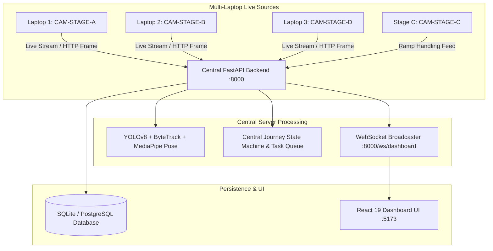

# BagGuard AI 🛡️✈️
### Intelligent Four-Stage Baggage Monitoring & Condition Assessment with 3 Live Laptop Cameras


**BagGuard AI** is a local-first prototype for monitoring baggage across four stages. It combines a React dashboard, FastAPI backend, SQLite persistence, camera agents, RFID development simulation, sample video processing, and a reviewer-confirmed computer-vision baseline. It is not a validated airport operations or baggage-damage detection system.

---

## 🌟 Key Highlights & Innovations

1. **Four-Stage Automated Baggage Monitoring:**
   - **Stage A — Initial Inspection (Laptop 1):** Live frames automatically detect and track bags; the existing image inspection workflow supports multi-angle capture, RFID association, and reviewable baseline-CV damage candidates.
   - **Stage B — Conveyor Monitoring (Laptop 2):** Live frames automatically detect and track bags and report view duration, movement in pixels per second, frame occupancy, idle time, and observed throughput. Physical speed requires camera calibration.
   - **Stage C — Manual Handling:** A connected handling camera detects and tracks luggage, estimates back/knee posture, measures risky-posture duration, and creates posture or rough-handling incident candidates for review. Risk scores are heuristic and are not probabilities of damage.
   - **Stage D — Final Inspection (Laptop 3):** A final inspection can be compared with the initial record and reported as possible change; image differences alone do not prove when damage occurred.

2. **Three Separate Laptops as Live Camera Sources:**
   - **Laptop 1 (`CAM-STAGE-A`)**: Connects to Laptop 1's webcam for Stage A check-in inspection.
   - **Laptop 2 (`CAM-STAGE-B`)**: Connects to Laptop 2's webcam for Stage B conveyor tracking.
   - **Laptop 3 (`CAM-STAGE-D`)**: Connects to Laptop 3's webcam for Stage D arrival inspection.
   - **Stage C (`CAM-STAGE-C`)**: Connect a dedicated handling-area camera with the browser or native camera agent; its feed and live baggage tracks appear on the Manual Handling page.
   - All live stage feeds run luggage detection and tracking and display backend annotations and metrics. Visual track IDs are temporary and reset if the backend restarts; cameras cannot confirm RFID or passenger identity. When YOLO weights are unavailable, contour detections are labeled “possible bag.” Damage and handling flags are review candidates, not confirmed findings. Damage change comparison still requires a confirmed bag identity and inspection views.
   - Stage C posture metrics use a single-view 2D pose heuristic; torso twist is unavailable from that view. Pixel speed and drop height require physical camera calibration before conversion to m/s or cm. The packaged damage baseline is a heuristic, not a validated damage detector, and damage-detection rate needs labeled validation data.
- Initial and final inspections queue a persisted report row. To enable Groq report text, set `GROQ_API_KEY`, `GROQ_MODEL`, and `GROQ_REPORTS_ENABLED=True` in the backend `.env`; keep the key server-side and never use a `VITE_` variable. Without configuration, inspections still save and reports remain `PENDING` with a setup status. PDFs use the saved report content and are stored under `storage_data/reports`.
- SQLite creates the new report table and extends handling/alert columns on startup. Supabase/PostgreSQL users must apply `supabase/migrations/20261011_inspection_reports_and_handling_alerts.sql` before deploying this version.

3. **Development station profiles & dedicated stage landing:**
   - **Laptop 1 (`laptop1` / `stage1pass`)**: Automatically lands on **Stage A (Initial Inspection)** with embedded live feed & 1-click laptop webcam streaming.
   - **Laptop 2 (`laptop2` / `stage2pass`)**: Automatically lands on **Stage B (Conveyor Tracking)** with live belt telemetry & 1-click laptop webcam streaming.
   - **Laptop 3 (`laptop3` / `stage3pass`)**: Automatically lands on **Stage D (Destination Reclaim)** with optical defect comparison & 1-click laptop webcam streaming.
   - **Supervisor (`admin` / `adminpass`)**: Central airport command with unified 4-camera live grid, incident triage, and analytics.
   - These prototype accounts and camera registration flow are for development use. The API does not implement production operator authorization; deploy only behind a properly secured network and authentication layer.

4. **Deployable Frontend and Live Backend Connection:**
   - `vercel.json` publishes the React frontend; deploy the FastAPI backend separately and configure its URL with `VITE_API_URL` or the Station Login server settings.
   - Live dashboard data and camera frames come from the configured backend. Sample videos are labeled demo sources; they do not represent live detections.

5. **Strict Truth in Status & Real-Time WebSockets:**
   - Strict liveness enforcement: A camera is marked **online** *only* if the backend has received valid frames or health signals within the last 6 seconds; otherwise, it automatically transitions to **offline**.
   - Real-time updates delivered to the dashboard via WebSockets without manual page refresh.

6. **Centralized State Machine & Durable Task Queue:**
   - Journey states: `DETECTED` &rarr; `IDENTITY_PENDING` &rarr; `INITIAL_INSPECTION` &rarr; `INITIAL_COMPLETE` &rarr; `IN_TRANSIT` &rarr; `HANDLING_REVIEW_IF_NEEDED` &rarr; `DESTINATION_DETECTED` &rarr; `FINAL_INSPECTION` &rarr; `COMPLETED`.
   - Durable background processing job queue (`processing_jobs`) with bounded retries and recovery after service restarts.

---

## 🏗️ System Architecture



---

## 🚀 Quick Start Guide

### 1. Prerequisites
- **Python:** Windows setup downloads a project-local Python 3.11 x64 runtime for computer vision.
- **Node.js:** 20 or newer

### 2. Setup

On Windows, run `setup_windows.bat`. On Linux/macOS, run `bash setup_unix.sh`. These create a local Python environment, install backend and frontend dependencies, and copy `.env.example` to `.env` if needed. SQLite is the default; Supabase credentials are optional.

To launch both services on Windows, run `start_server_lan.bat`. Alternatively, start them separately:

#### Backend and database

```bash
# On Windows:
.venv\Scripts\python.exe -m uvicorn backend.app.main:app --host 0.0.0.0 --port 8000
# On Linux/macOS, use .venv/bin/python instead.
```

- API Base: `http://127.0.0.1:8000/api`
- Swagger UI: `http://127.0.0.1:8000/docs`
- Health: `http://127.0.0.1:8000/api/health`

#### Frontend dashboard

```bash
cd frontend
npm install
npm run dev -- --host 0.0.0.0 --port 5173
```

- Web App: `http://127.0.0.1:5173/`

### 3. Connect the 3 Laptop Cameras

#### Method 1: Browser Web Agent (No Python install needed on laptops!)
Open a browser on each laptop on the same Wi-Fi:
- **Laptop 1:** `http://<SERVER_IP>:5173/agent?stage=stage_a&laptop=laptop-1`
- **Laptop 2:** `http://<SERVER_IP>:5173/agent?stage=stage_b&laptop=laptop-2`
- **Laptop 3:** `http://<SERVER_IP>:5173/agent?stage=stage_d&laptop=laptop-3`
- **Stage C handling camera:** `http://<SERVER_IP>:5173/agent?stage=stage_c&laptop=handling-bay`
Click **Start Live Camera Stream**.

#### Method 2: Python Native Agent
On Laptop 1:
```bash
python camera_agent/agent.py --server http://<SERVER_IP>:8000 --stage stage_a --laptop-id laptop-1
```
On Laptop 2:
```bash
python camera_agent/agent.py --server http://<SERVER_IP>:8000 --stage stage_b --laptop-id laptop-2
```
On Laptop 3:
```bash
python camera_agent/agent.py --server http://<SERVER_IP>:8000 --stage stage_d --laptop-id laptop-3
```

See [Multi-Laptop Setup](docs/MULTI_LAPTOP_SETUP.md) for network and firewall configuration. Camera frame and heartbeat calls require per-camera tokens, but enrollment and operator API authorization are not production-ready; keep the service on a trusted development network until those controls are added.

---

## 🧪 Automated Tests

Run all tests:
```bash
python -m pytest backend/tests/test_all.py backend/tests/test_multilaptop.py -v
```

The tests cover scoring, RFID uniqueness, inspection/handling persistence, camera liveness/authentication, journey transitions, job recovery, and an API workflow. Test execution depends on an installed Python environment and the dependencies in `backend/requirements.txt`.

---

## 📚 Technical Documentation

- [Multi-Laptop Setup Guide](docs/MULTI_LAPTOP_SETUP.md): Windows network setup, firewall rules, and camera commands.
- [System Architecture](docs/ARCHITECTURE.md): Sequence diagrams and computer-vision pipeline notes.
- [REST API Specification](docs/API.md): Camera, baggage, and inspection endpoints.
- [Database ERD & Schema](docs/DATABASE_ERD.md): Schema and relationships.
- [PostgreSQL & Supabase Migration](supabase/migrations/20261011_multilaptop_automation.sql).

---

## ⚖️ License

Distributed under the MIT License. See `LICENSE` for details.
